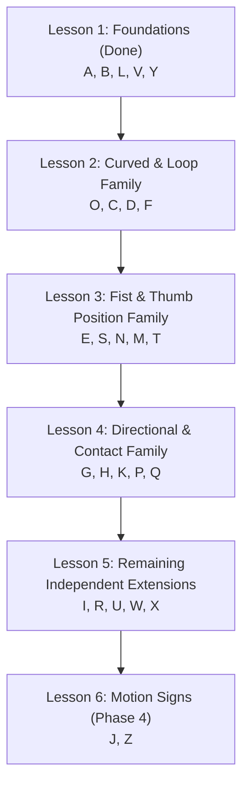
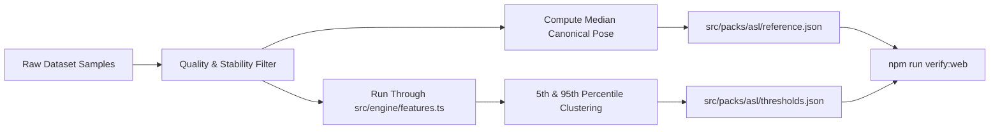
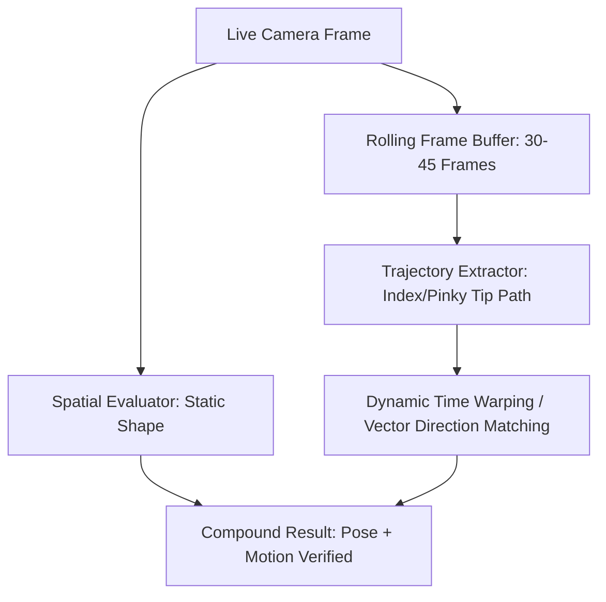

# ASL Practice Coach — Master Strategic Plan & Roadmap

*Generated: November 2026 · Target: v0.2.0 through v1.0.0*  
*Project Workspace: `c:\Users\DSU\Downloads\PROGRAMMING\ASL Practice Coach`*

---

## Executive Summary

ASL Practice Coach has completed its initial foundational release (**v0.1.0**):
- **Core Engine:** Biomechanically validated, zero-DOM mathematical evaluation pipeline (`src/engine/`).
- **Validated Signs:** 5 signs (A, B, L, V, Y) with 100% accuracy on held-out benchmarks.
- **Desktop Support:** Electron wrapper with custom `app://asl` privileged protocol, offline execution, and automated GitHub Actions CI generating Windows NSIS installers.
- **Brand Identity:** Muscle-Memory Loop identity (Charcoal, Amber, Mint, Eggshell) integrated into UI and metadata.

This plan details how we scale from 5 signs to the complete 26-letter ASL alphabet, expand curriculum lessons, automate threshold derivation, elevate UX/accessibility, and support multi-platform distribution.

---

## Phase Breakdown Matrix

| Phase | Focus Area | Estimated Horizon | Core Deliverable |
|---|---|---|---|
| **Phase 1** | Immediate Fixes & CI Hardening | Week 1 | Desktop app icon, CI PR check, Node 24 Action updates |
| **Phase 2** | Automated Sign Data Pipeline & Lessons 2–5 | Weeks 2–6 | 19 static letters added via automated bootstrap script |
| **Phase 3** | UX, Habit Formation & Accessibility | Weeks 7–10 | Onboarding, difficulty presets, streak counter, PWA offline worker |
| **Phase 4** | Temporal Engine (Motion Signs J & Z) | Weeks 11–14 | Dynamic trajectory recognition, digit signs (0–9) |
| **Phase 5** | Multi-Platform & Distribution Polish | Months 4–6 | macOS/Linux CI builds, Windows Code Signing, Auto-updates |

---

## Phase 1: Immediate Fixes & CI Hardening (Week 1)

### Objectives
1. **Wire Desktop App Icon:** Ensure the NSIS installer and Windows taskbar display the Muscle-Memory Loop icon instead of the default Electron icon.
2. **Pull Request Quality Gate:** Run `npm run verify:web` on pull requests to prevent regressions from landing on `main`.
3. **Upgrade Deprecated GitHub Actions:** Eliminate Node 20 deprecation warnings on GitHub Actions runners.

### Step-by-Step Operator Guide
- [ ] **1.1. Add icon configuration in `package.json`:**
  Under the `"build"` block, configure:
  ```json
  "win": {
    "target": "nsis",
    "icon": "public/icon-512.png"
  }
  ```
- [ ] **1.2. Create PR verification workflow:**
  Create `.github/workflows/pr-verify.yml` triggered on `pull_request: [main]` executing `npm run verify:web`.
- [ ] **1.3. Modernize Action dependencies:**
  Update action versions in `.github/workflows/build-desktop.yml`:
  - `actions/checkout@v4`
  - `actions/setup-node@v4` (targeting node-version: 22.x or 24.x)
  - `actions/upload-artifact@v4`
  - `softprops/action-gh-release@v2`

---

## Phase 2: Sign Expansion via Automated Pipeline (Weeks 2–6)

### Objectives
Expand from 5 signs to 24 static signs without tedious manual entry. Use automated batch statistical extraction while maintaining biomechanical invariants.

### Pedagogical Curriculum Structure

Group signs by **handshape family** to accelerate motor skill acquisition:



### Data Sourcing Strategy

1. **Primary Dataset:** *Google ASL Fingerspelling Kaggle Dataset (2023)*.
   - Over 27,000 recorded video sequences.
   - Direct 21-point MediaPipe hand landmark format (`x, y, z`).
2. **Visual & Error Verification:** *Lifeprint (Dr. Bill Vicars / ASL University)* & *Handspeak*.
   - Canonical definitions of thumb placement, contact points, and common beginner errors.

### The Automated Bootstrap Pipeline

Rather than guessing numbers, run a script (`scripts/bootstrap-signs.ts`):



### Step-by-Step Operator Guide for Phase 2

#### Step 1: Download & Ingest Dataset
- [ ] Register/log in to Kaggle and navigate to `kaggle.com/competitions/asl-fingerspelling`.
- [ ] Download raw landmark parquet/CSV files for target signs.
- [ ] Place raw landmark samples in `scripts/data/raw/` (ignored by git).

#### Step 2: Implement & Run Bootstrap Script
- [ ] Create `scripts/bootstrap-signs.ts`.
- [ ] For each letter:
  - Aggregate 100+ stable frames.
  - Compute median coordinate for all 21 points $\to$ output to `reference.json`.
  - Pass all frames through `computeHandFeatures()` in `src/engine/features.ts`.
  - Calculate 5th percentile (min) and 95th percentile (max) with a 10% safety buffer $\to$ draft `thresholds.json`.

#### Step 3: Biomechanical Sanity Check
- [ ] Cross-reference each generated sign against Lifeprint.
- [ ] Verify tendon coupling constraints (e.g., extensor tethering between middle, ring, pinky).
- [ ] Populate `feedback.json` with descriptive beginner tips (e.g., *"Tuck your thumb across your index and middle fingers"*).

#### Step 4: Verification Gate
- [ ] Run `npm run verify:web`.
- [ ] Update `tests/fixtures/evaluationSnapshot.json` only after human validation confirms 0 regressions.

---

## Phase 3: Core UX, Habit Formation & Accessibility (Weeks 7–10)

### Objectives
Transform the practice utility into an engaging, habit-forming coach accessible to all learners.

### Feature Specifications

1. **First-Run Onboarding Flow:**
   - 3-step interactive setup card:
     1. Camera permission & lighting calibration.
     2. Framing reticle positioning (distance & hand centering).
     3. Explanation of the hold timer & feedback cues.

2. **Practice Settings & Difficulty Tiers:**
   - **Beginner:** 1.5s stable hold required, relaxed curl tolerances (+10°).
   - **Standard:** 2.0s stable hold required (default).
   - **Advanced:** 3.0s stable hold required, strict spread and curl bounds.

3. **Habit Loop & Local Progress Persistence:**
   - Local-only IndexedDB storage (`idb-keyval`).
   - Daily practice streak counter (midnight reset with timezone awareness).
   - Mastery badges: *First Sign*, *Lesson Complete*, *7-Day Streak*, *Clean Sweep (0 adjustments)*.

4. **Accessibility (WCAG 2.1 AA Compliance):**
   - High-contrast mode toggle (`--bg-color: #000000`, `--text-color: #FFFFFF`, `--accent-color: #00FFCC`).
   - Comprehensive keyboard navigation with visible focus rings (`:focus-visible`).
   - Enhanced screen reader live announcements for hold progression.

5. **Progressive Web App (PWA) Offline Caching:**
   - Implement Service Worker caching for:
     - MediaPipe WASM binaries (`@mediapipe/tasks-vision`).
     - App bundle and reference imagery.
   - Enable full offline practice in browser mode without internet connectivity.

---

## Phase 4: Temporal Engine — Motion Signs J & Z (Weeks 11–14)

### Objectives
Implement path/trajectory recognition over time to support the dynamic letters **J** (scooping rotation) and **Z** (zigzag stroke), followed by numerical digits **0–9**.

### Architecture Evolution



### Technical Requirements
- Maintain a rolling circular buffer of fingertip coordinates for the preceding 1000ms.
- Normalize motion vectors against wrist movement (cancel out head/torso motion).
- Template matching using stroke direction sequences:
  - **Z:** Right $\to$ Down-Left $\to$ Right.
  - **J:** Down $\to$ Smooth Counter-Clockwise Curve $\to$ Upward flick.

---

## Phase 5: Multi-Platform & Distribution Polish (Months 4–6)

### Objectives
Enable widespread installation across desktop ecosystems with zero friction.

1. **Code Signing:**
   - Integrate Windows Authenticode code signing in GitHub Actions using SignPath.io (free for open-source) or hardware/cloud EV token.
   - Eliminates Microsoft Defender SmartScreen prompts.
2. **Cross-Platform Packaging:**
   - macOS workflow runner (`macos-latest`) producing signed `.dmg` binaries (Universal x64/arm64).
   - Linux workflow runner (`ubuntu-latest`) producing `.AppImage` and `.deb`.
3. **Auto-Updater Integration:**
   - Electron `autoUpdater` querying GitHub Releases API with sha512 validation.

---

## Project Guardrails & Invariants

> [!CAUTION]
> **Non-Negotiable Engineering Rules**
> 1. **Zero-DOM Engine:** `src/engine/` must remain pure mathematical logic. No React imports, no browser window references.
> 2. **Evaluation Invariant:** Never modify `tests/fixtures/evaluationSnapshot.json` without review.
> 3. **Verification Pipeline:** `npm run verify:web` must pass at 100% before any commit.
> 4. **No External Network Dependencies:** Production runtime must operate completely offline.
> 5. **Text-First Accessibility:** Visual states must always have corresponding text or ARIA counterparts.

---

## Immediate Next Steps Checklist for You

When you are ready to begin execution:

- [ ] **Step 1:** Review this plan and confirm if Lesson 2 (O, C, D, F) should be our first expansion target.
- [ ] **Step 2:** Wire the desktop application icon in `package.json` to eliminate the Electron default icon warning in CI.
- [ ] **Step 3:** Add `.github/workflows/pr-verify.yml` to ensure every PR runs the automated 6-stage verification suite.
