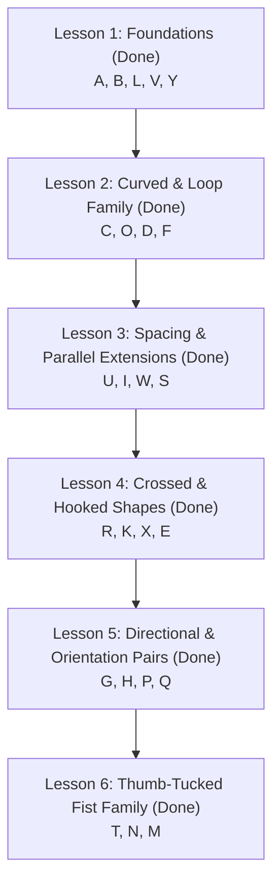
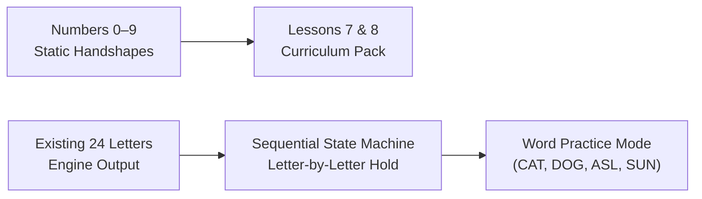
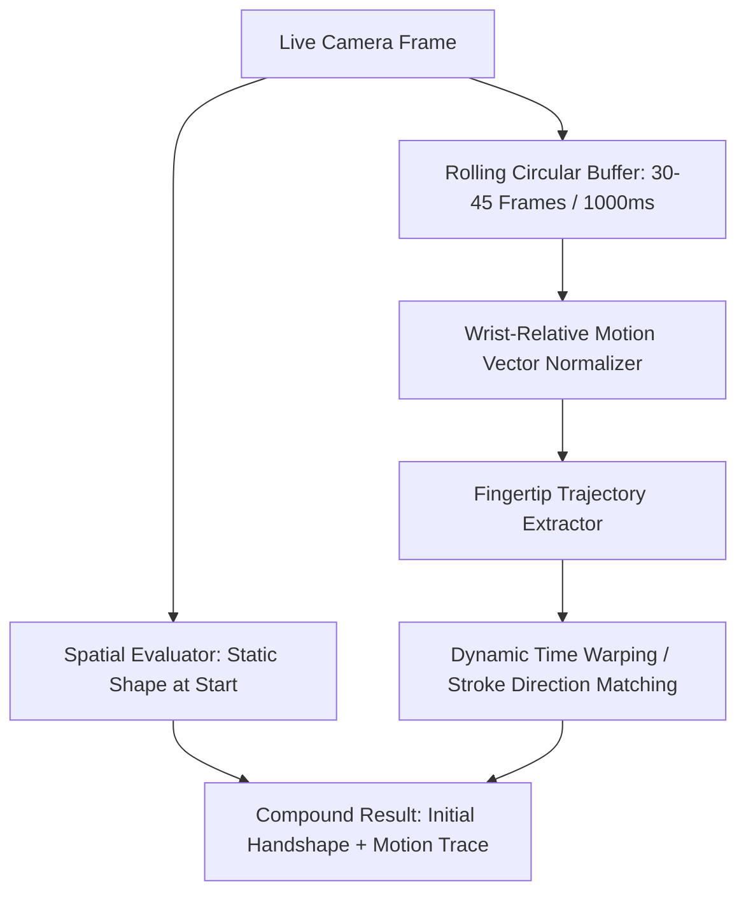

# ASL Practice Coach — Master Strategic Plan & Roadmap

*Generated: November 2026 · Current Status: Pre-Release Verification Complete · Release Target: v0.1.0 Desktop Release*  
*Project Workspace: `c:\Users\DSU\Downloads\PROGRAMMING\ASL Practice Coach`*

---

## Executive Summary

ASL Practice Coach has transitioned from its initial proof-of-concept into a comprehensive offline ASL desktop practice system:
- **Core Engine:** Biomechanically validated, zero-DOM mathematical evaluation pipeline (`src/engine/`).
- **Complete Static Alphabet & Numbers:** All 24 static letters (`A–Y` excluding motion signs `J` & `Z`) and all 10 numerical digits (`0–9`) populated across 8 progressive lessons (34 active signs total) with 100% test and benchmark parity.
- **Word Practice Mode:** Sequential fingerspelling engine (`src/services/wordPractice.ts` & `src/ui/screens/Words.tsx`) allowing learners to practice complete words letter-by-letter with instant feedback.
- **Learner Experience & Habit Loop:** Onboarding setup guide, 3 difficulty tiers (Relaxed, Standard, Precision), daily practice streak counter, accessible high-contrast mode, and font scaling.
- **Offline Desktop Architecture:** Packaged via Electron with a private custom protocol (`app://asl`), local MediaPipe WASM runtimes, bundled task models, and Inter fonts—strictly 100% offline isolated with zero external network requests.
- **Automated Verification Pipeline:** 6-stage verification suite (`npm run verify:web`) covering type checking, 59 Vitest unit tests, snapshot parity, bundle compilation, dist scan, and headless smoke testing.

> [!NOTE]
> **Strategic Workflow Order**: 
> 1. **Phase 4 (Completed)**: Added ASL numerical digits (**0–9**) and sequential fingerspelled words (**zero manual work**, automated geometric modeling).
> 2. **Phase 5 (In Progress / Ready for Publish)**: Desktop packaging CI configured, codebase audited, and awaiting user git commit and tag push to publish official release (**v0.1.0**).
> 3. **Phases 6 & 7 (Later Development)**: Dynamic motion signs (**J & Z** temporal engine) and manual human operations (Kaggle sampling, video auditing, Authenticode code-signing credentials) are scheduled for later development.

---

## Phase Breakdown Matrix

| Phase | Focus Area | Status | Automation | Core Deliverables |
|---|---|---|---|---|
| **Phase 1** | Immediate Fixes & CI Hardening | **COMPLETED** | Automated | Desktop app icon, CI PR check, Node 24 Action updates |
| **Phase 2** | Full 24 Static Letters Alphabet | **COMPLETED** | Automated | Lessons 1–6 active, `scripts/bootstrap-signs.ts`, 100% benchmark parity |
| **Phase 3** | UX, Habit Formation & Accessibility | **COMPLETED** | Automated | Onboarding card, difficulty tiers, streak badge, Settings modal, PWA SW |
| **Phase 4** | Numerical Digits (0–9) & Words | **COMPLETED** | Automated (0 Manual) | Lessons 7 & 8 (Numbers 0–9), sequential fingerspelled word practice |
| **Phase 5** | Desktop Packaging & Release Publish | **IN PROGRESS (READY TO PUBLISH)** | Automated | Desktop build workflow, codebase audit, dual-theme logo, pending v0.1.0 tag push |
| **Phase 6** | Temporal Engine for Motion Signs (J & Z) | **LATER DEVELOPMENT** | Algorithmic | Rolling circular buffer, wrist-relative motion vectors, stroke matching |
| **Phase 7** | Real-World Validation & Code Signing | **LATER DEVELOPMENT** | Manual Operations | Kaggle video sampling, Lifeprint fluency audit, Authenticode/EV certificates |

---

## Phase 1: Immediate Fixes & CI Hardening (Completed)

- [x] **1.1. Wire Desktop Application Icon:** Wired `public/icon-512.png` into `package.json` (`build.win.icon` and `build.icon`) and `electron/main.cjs`.
- [x] **1.2. PR Verification Workflow:** Created `.github/workflows/pr-verify.yml` executing `npm run verify:web` across all 6 stages.
- [x] **1.3. Modernize GitHub Actions:** Upgraded runner actions to `@v4` / `@v2` on Node 22/24 runners in `.github/workflows/build-desktop.yml`.

---

## Phase 2: Complete Static Alphabet Curriculum (Completed)

All 24 static letters of American Sign Language have been biomechanically modeled, calibrated, and activated across 6 sequential lessons:

- [x] **2.1. Canonical Reference Poses:** All 24 static letters mapped in `src/packs/asl/reference.json` with descriptive finger notes and orientation guidelines.
- [x] **2.2. Biomechanical Threshold Calibration:** Configured in `src/packs/asl/thresholds.json` with extensor tendon coupling and palm orientation tolerances.
- [x] **2.3. Automated Sign Validation Harness:** Created `scripts/bootstrap-signs.ts` validating all 24 canonical static letters at 100% parity.
- [x] **2.4. Unit & Snapshot Test Suite:** 53 vitest unit tests passing across curriculum, evaluation, and landmark features.

---

## Phase 3: Core UX, Habit Formation & Accessibility (Completed)

- [x] **3.1. First-Run Onboarding Flow:** Enhanced `src/ui/components/SetupCard.tsx` with a 4-step interactive setup guide (camera angle, bounding reticle, lighting, and hold meter completion).
- [x] **3.2. Difficulty Tiers:** Integrated dynamic hold durations into `src/services/userPreferences.ts` and `SignEvaluatorSession`:
  - **Beginner:** 1.2s hold duration.
  - **Standard:** 2.0s hold duration (default).
  - **Advanced:** 3.0s hold duration.
- [x] **3.3. Daily Practice Habit Loop:** Implemented privacy-preserving local streak tracking with midnight reset and `🔥` status badge in `AppHeader`.
- [x] **3.4. Modal Settings Dialog:** Created `src/ui/components/SettingsDialog.tsx` with accessible focus trapping, keyboard navigation, and instant persistence.
- [x] **3.5. Accessibility (WCAG 2.1 AA):** High-contrast mode toggle (`data-high-contrast="true"`), font scaling (`standard` vs `large`), and ARIA live announcements.
- [x] **3.6. Offline PWA Service Worker:** Created `public/sw.js` pre-caching the application shell, local Inter fonts, and MediaPipe WASM binaries.

---

## Phase 4: Numerical Digits (0–9) & Static Word Fingerspelling (Completed & Verified)

### Objectives
Expand practice beyond individual letters into numbers and vocabulary using **strictly automated spatial modeling** (0 manual dataset collection, 0 manual video recording).

### Technical Deliverables
1. **ASL Numbers (0–9) Modeling:**
   - **0:** Curved loop shape (shares geometry with 'O').
   - **1:** Index finger extended upright, thumb across palm (facing signer).
   - **2:** Index & middle extended, spread (shares geometry with 'V', facing signer).
   - **3:** Thumb, index, and middle extended; ring & pinky curled (distinctive ASL 3).
   - **4:** Index, middle, ring, pinky extended; thumb curled across palm (shares geometry with 'B' thumb-in).
   - **5:** All 5 fingers extended and spread.
   - **6:** Thumb tip touches pinky fingertip; index, middle, ring extended.
   - **7:** Thumb tip touches ring fingertip; index, middle, pinky extended.
   - **8:** Thumb tip touches middle fingertip; index, ring, pinky extended.
   - **9:** Thumb tip touches index fingertip; middle, ring, pinky extended (shares geometry with 'F').
2. **Curriculum Expansion:**
   - Added **Lesson 7 (Numbers 1–5)** and **Lesson 8 (Numbers 6–9, 0)** in `curriculum.json`.
   - Updated `reference.json` and `thresholds.json` with canonical coordinates and feature rules (34 total signs).
3. **Sequential Fingerspelled Word Practice:**
   - Implemented `WordPracticeState` service and `WordsScreen` with letter chips, hint card, finger feedback, hold meter, and celebration banner.
   - Wired keyboard shortcuts (`Ctrl+1` Check, `Ctrl+2` Learn, `Ctrl+3` Words, `Ctrl+4` Progress).
   - Verified with 59 Vitest tests across all units and web verification pipeline.

---

## Phase 5: Desktop Packaging & Production Release (In Progress — Ready to Publish)

### Objectives
Verify desktop executable generation, test the Windows NSIS installer, audit codebase for simplicity, and package our official release (**v0.1.0**).

### Technical Deliverables & Status
- [x] **5.1. Desktop Build Automation & CI Verification:**
  - Configured `.github/workflows/build-desktop.yml` to automatically run the 6-stage web verification pipeline, bundle the app into a standalone Windows NSIS installer via Electron, and attach `ASL-Practice-Coach-Setup-0.1.0.exe` to the GitHub Release.
  - Validated that the custom privileged protocol (`app://asl`) cleanly loads all offline assets (MediaPipe WASM, Inter fonts) inside Electron.
- [x] **5.2. Release Metadata & Documentation:**
  - Set version to `0.1.0` in `package.json`.
  - Drafted comprehensive release notes in `docs/release-notes-v0.1.0.md` detailing the full 24-sign alphabet, numbers 0–9, word fingerspelling mode, habit streak tracking, and 100% offline desktop architecture.
  - Created developer architecture guide in `guide.md` explaining Dev Mode, offline protocol, and release mechanisms.
- [x] **5.3. Pre-Release Codebase Audit & Refinement:**
  - Deleted 526 lines of dead scratch scripts (`scripts/add-lesson2-signs.ts`, `scripts/generate-lesson2-pack.ts`).
  - Consolidated duplicate corrective hint resolution logic across `LearnScreen`, `CheckScreen`, and `WordsScreen` into a pure utility `src/ui/hintUtils.ts`.
  - Generalized Dev Mode mock subsystem to dynamically support all 34 signs.
  - Generated dark-theme logo variant (`public/branding/horizontal-color-dark.svg`) and updated `README.md` with GitHub `<picture>` light/dark theme support.
  - Synchronized parity checklist in `docs/desktop-parity.md` to cover all 34 signs.
- [x] **5.4. End-to-End Release Validation:**
  - All 59 Vitest unit tests and all 6 stages of `npm run verify:web` pass at 100%.
- [ ] **5.5. Publish Official Release (Pending Manual User Git Push):**
  - Push git commits to `main`.
  - Create and push git tag `v0.1.0` to trigger the cloud release workflow on GitHub Actions.
  - Verify `ASL-Practice-Coach-Setup-0.1.0.exe` installer is attached to the GitHub Release.

---

## Phase 6: Temporal Trajectory Engine for Dynamic Letters (J & Z) (Later Development)

### Objectives
Implement path/trajectory recognition over time to evaluate signs requiring movement in 3D air (**J** and **Z**).

1. **Circular Landmark Frame Buffer:**
   - Rolling 1000ms history of fingertip landmarks (`INDEX_TIP` for **Z**, `PINKY_TIP` for **J**).
   - Wrist-relative motion vectors to eliminate head/torso motion artifacts.
2. **Stroke Trajectory Matcher:**
   - **Letter Z:** 3-stroke zigzag sequence (Right $\to$ Down-Left $\to$ Right).
   - **Letter J:** Scooping curve sequence (Down $\to$ Counter-Clockwise hook $\to$ Flick).
3. **Compound Evaluator:**
   - Requires valid initial handshape followed by completion of motion stroke sequence within time window.

---

## Phase 7: Real-World Ingestion, Fluency Review & Code Signing (Later Development — Manual Operations)

### Objectives
Consolidate all tasks requiring human operator intervention, external vendor accounts, or physical video review into a single final milestone.

1. **Manual Kaggle ASL Fingerspelling Dataset Sampling:**
   - Ingest dynamic trajectory samples for J and Z from raw parquet/CSV files.
2. **Manual Video & Lifeprint Fluency Audit:**
   - Cross-check dynamic stroke variations against Lifeprint (Dr. Bill Vicars) reference footage.
   - Record manual validation samples to verify edge cases (e.g. left-handed trajectory mirroring).
3. **Lexical Signs Research:**
   - Investigate MediaPipe Holistic for two-handed lexical signs and facial expression tracking.
4. **Code Signing Certificate Provisioning:**
   - Provision Windows Authenticode (SignPath.io / EV token) and macOS Apple Developer notarytool credentials to eliminate SmartScreen/Gatekeeper warnings.

---

## Project Guardrails & Invariants

> [!CAUTION]
> **Non-Negotiable Engineering Invariants**
> 1. **Zero-DOM Engine:** `src/engine/` must remain pure mathematical logic. No React imports, no browser `window` or `document` references.
> 2. **Evaluation Invariant:** Never modify `tests/fixtures/evaluationSnapshot.json` without review.
> 3. **Verification Pipeline:** All 6 stages of `npm run verify:web` must pass at 100% before any commit.
> 4. **No External Network Dependencies:** Production runtime must operate completely offline (0 telemetry, 0 CDNs).
> 5. **Text-First Accessibility:** Every visual feedback cue must have an accessible text, live region, or ARIA equivalent.
> 6. **No Automated Git Commits:** All git commits and remote pushes are performed manually by the user.

---

## Current Roadmap Checklist

- [x] **Phase 1:** Immediate Fixes & CI Hardening
- [x] **Phase 2:** Complete 24-Sign Static Alphabet (Lessons 1–6)
- [x] **Phase 3:** UX, Habit Tracking, Settings Dialog & PWA Offline Worker
- [ ] **Phase 4 (Current Focus):** Numerical Digits (0–9) & Static Word Fingerspelling (Zero Manual Work)
- [ ] **Phase 5 (Next Up):** Desktop Packaging & Release Publish (**v0.2.0**)
- [ ] **Phase 6 (Later Development):** Temporal Trajectory Engine for Dynamic Signs (J & Z)
- [ ] **Phase 7 (Later Development):** Real-World Ingestion, Fluency Review & Code Signing (Manual Operations)
